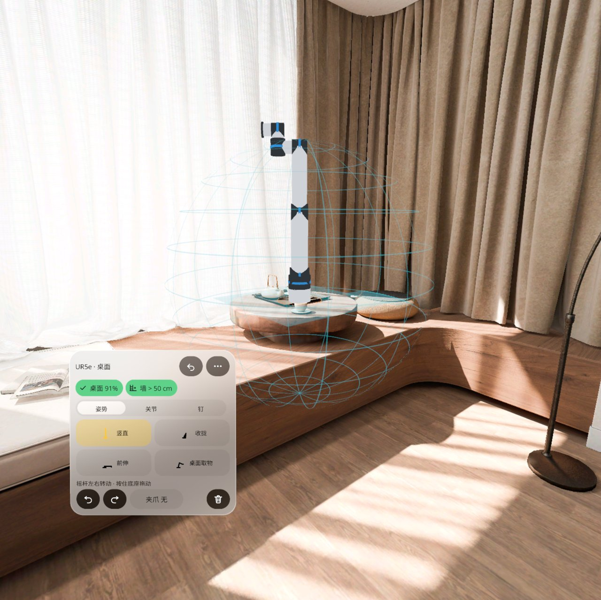
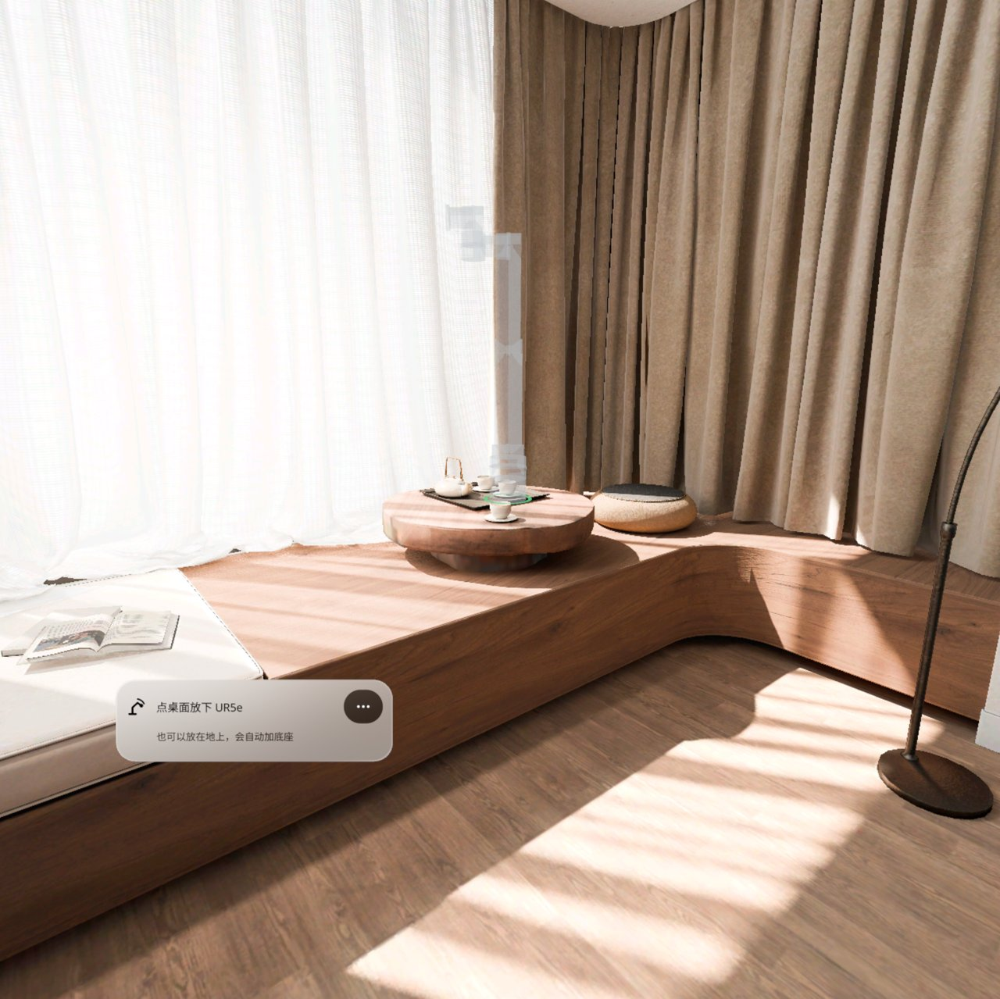
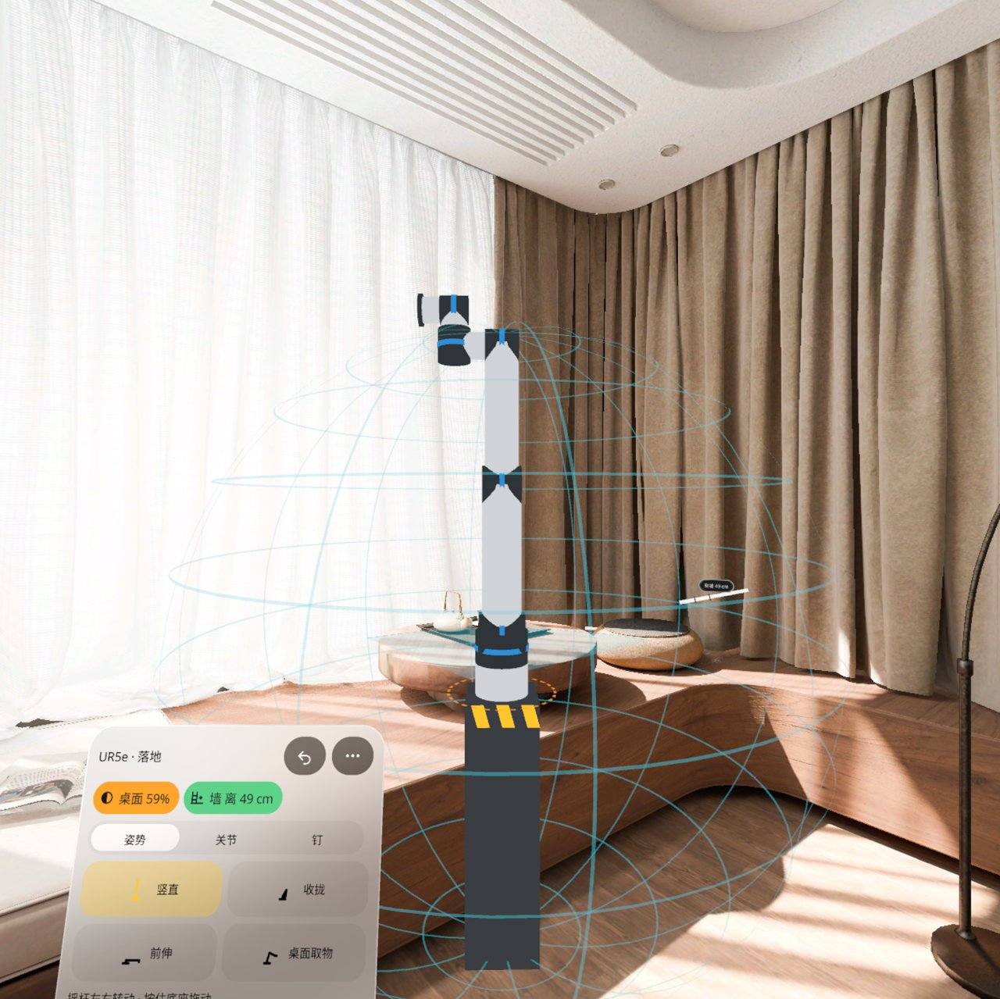
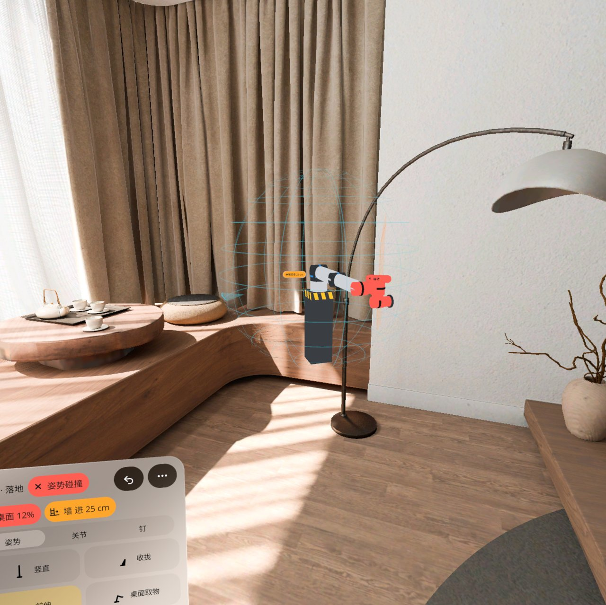
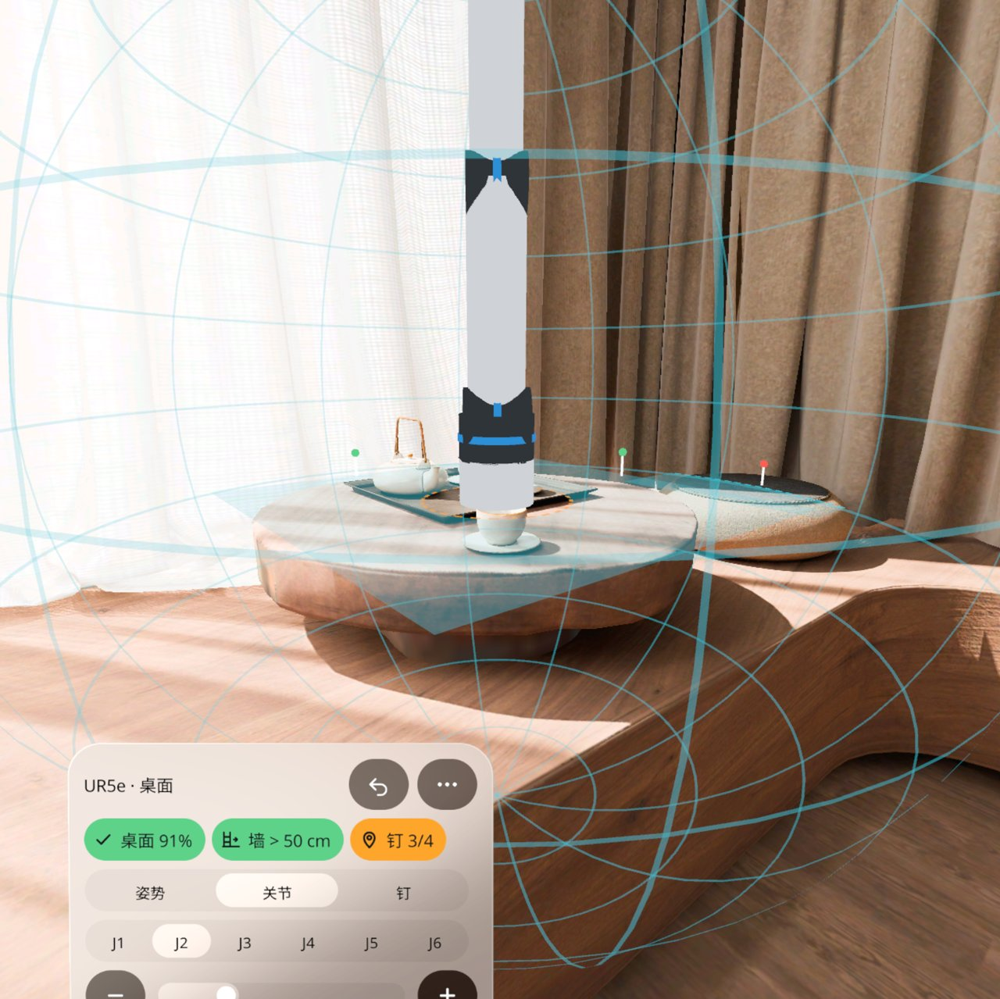
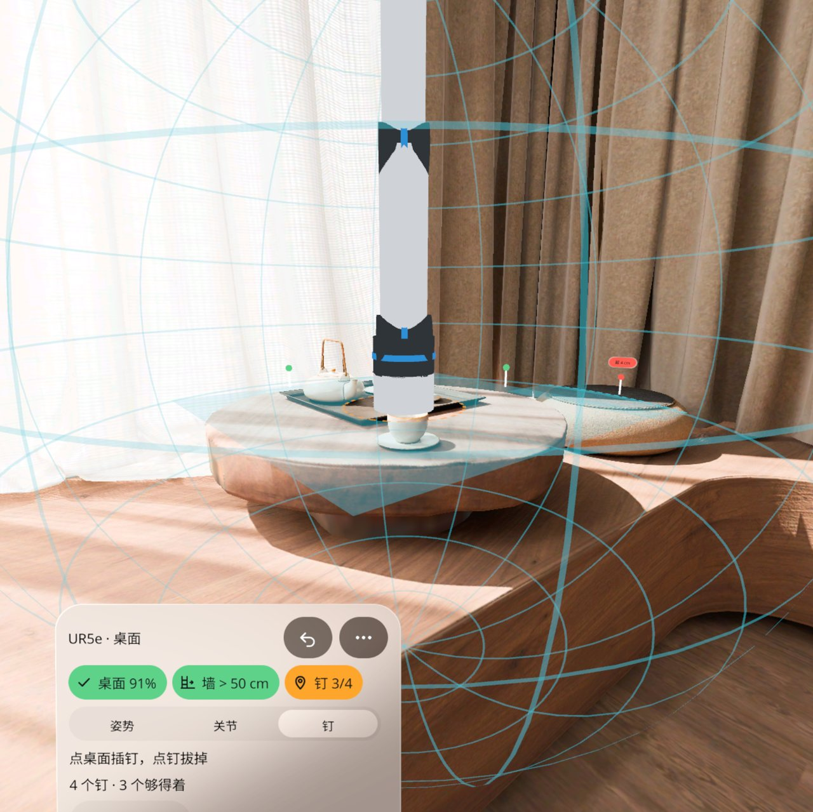
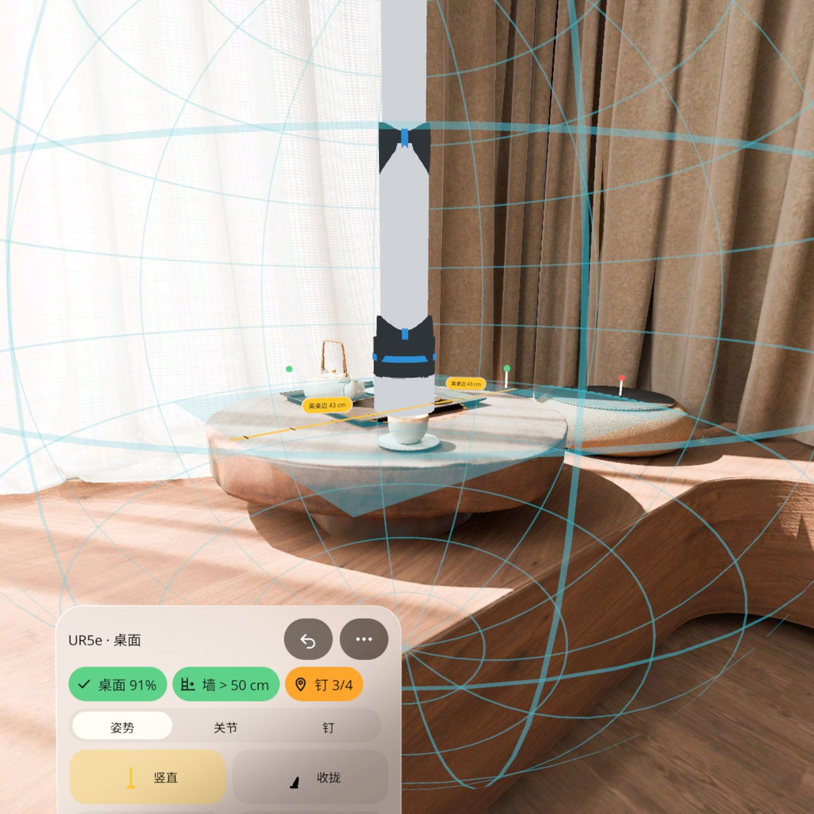
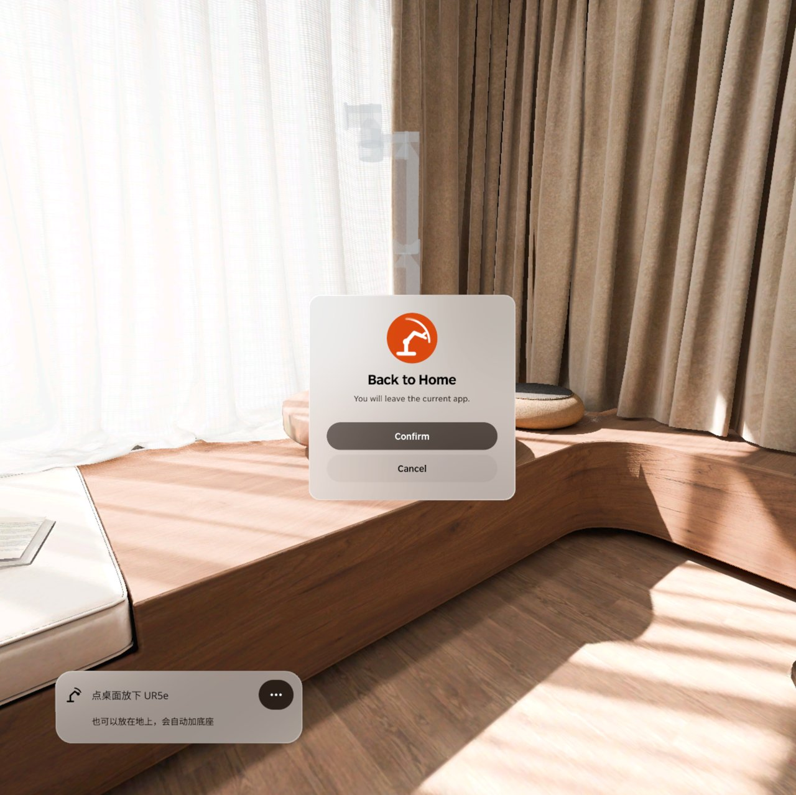

<p align="center"></p>

# Robot Cell Fit | 机器人工位

**把一台 1:1 的 UR5e 放到你的真桌边，一眼看出它够得着桌面哪里、全伸展会不会到墙、典型姿势会不会碰墙碰桌。**

**Put a life-size UR5e on your real desk and see at a glance which part of the desk it can reach, whether full extension hits the wall, and whether typical poses collide with the wall or the desk.**

PICO OS 6 · PICO Spatial SDK 6.1.9 · Kotlin / SpatialUI · package `io.embodit.robotcell` · v0.1.1 (pre-release / 预发布)

> **模拟器 QA 通过，真机未验证（Simulator-QA passed; not yet verified on a real headset）。**



> 截图和演示视频来自原生模拟器（PICO Emulator 6.1），由调试广播驱动跳转到各设计状态；**非真实手势录像**。
> Screenshots and the demo video were taken on the native PICO emulator, driven by debug broadcasts that jump to each design state; **not a recording of real hand gestures.**

---

## 中文

### 这是什么

搭机器人采数工位之前，先在你的真实房间里摆一台 1:1 的 UR5e 看看。指向桌面点一下，机器人就立在桌上；指向地面，它会站在一个和旁边桌面一样高的黄黑条纹底座上。周围画出经纬线可达球，桌上涂出它够得着的工作盘，面板上的判定条直接写「桌面 91% · 墙 > 50 cm」。

点「竖直 / 收拢 / 前伸 / 桌面取物」四个姿势，机械臂动过去；穿进墙或桌子的那几段变红，名牌旁亮出「姿势碰撞」。伸展会碰到墙时，墙上亮出橙圈和读数牌「伸展超墙 7 cm」。也可以逐个关节调角度，在桌上插钉标出要够到的位置（够不着的钉变红、写「超 14 cm」），按住底座拖动时画出到两条桌边的尺带。工位会存下来，下次打开自动找回。中英双语，cm / in 可切，全部本机保存，不联网。

### 安装与启动

```bash
adb install -r RobotCellFit-v0.1.1.apk
pico-cli app launch io.embodit.robotcell
```

APK 在 [Releases](https://github.com/kejing-dev/RobotCellFit/releases) 页面下载（仓库不含 APK）。需要 PICO OS 6 头显或 PICO Emulator 6.1；用到平面识别和空间锚点。APK 约 45 MB。

### 容器与骨架

- **容器**：只有 Full Space · `STAGE_MIXED`（透视），没有 Shared Space 版本。机器人要 1:1 落在真实桌面 / 地板上，并和真实墙、桌边算距离；UR5e 伸展直径 1.7 m，比任何窗口都大。平面识别、世界锚点只在 Full Space 可用。
- **骨架 D**（同火情预案 Fire Plan / 空间尺 Spatial Ruler）：平面识别（TABLE / FLOOR / WALL）、世界锚点、懒跟随面板、面板池、每帧系统里算姿势动画、碰撞、净距和可达判定。开场的 3D 网格按帧排队生成，避免主线程卡住。
- **状态**：设计包 21 个状态（S01–S21），全部可由调试广播直接跳转并截图，结构见 [AGENTS.md](AGENTS.md)。

### 截图

| | |
|---|---|
|  |  |
| 瞄准 — 半透明虚影跟着视线，绿圈表示能放 | 落地 — 自动加一个和桌面齐平的底座 |
|  |  |
| 姿势碰撞 — 前伸穿墙的几段变红，「墙 进 25 cm」 | 关节 — J1–J6 逐个调，±5° 微调 |
|  |  |
| 钉 — 4 个钉 3 个够得着 | 拖动 — 实时显示离两条桌边多远 |

启动器图标：



### 已知问题（QA 第 2 轮，不影响使用）

- 空闲模拟器上首次打开约 26–30 秒才出机器人：开场的 3D 模型改成一个个排队生成，模拟器空闲时每秒只画 1–2 帧，所以慢；真机帧数高，会快得多。
- 面板默认位置偏低，平视时最下面一行（↺ ↻、夹爪、删除）和「摇杆左右转动」提示行在视野外，要稍微低头。
- 模拟器里墙上的橙圈被房间窗帘挡住看不见；读数牌「伸展超墙 7 cm」和判定条正常。
- 用调试命令模拟「没认出桌子」时，指向桌子的落点圈仍是绿的（桌子其实已经认出来了）。
- 「上次的工位不在这里」时，面板的瞄准行看不出变淡。
- 离 2 米以外时，引导气泡和读数牌上的字很小；走近到 1.2 米左右就清楚。

还没在头显上验过：手柄摇杆转动机器人和松手吸附、捏住底座拖动的手感、碰撞轻振（本版没做）、真实桌面轮廓识别、关机重开后找回工位、权限弹窗。

---

## English

### What it is

Before building a robot data-collection cell, try a life-size UR5e in your real room. Point at the desk and tap: the robot stands on it. Point at the floor and it stands on a yellow-and-black striped pedestal as high as the nearby desk. A wireframe reach sphere surrounds it, the reachable work disc is painted on the desk, and the verdict bar on the panel reads e.g. "Desk 91% · Wall > 50 cm".

Tap one of four poses (upright, tucked, reach forward, desk pick) and the arm moves there; links that pass into a wall or the desk turn red and a "Pose collision" tag appears. When full extension would hit the wall, an orange ring and a "Reach past wall 7 cm" plate light up on the wall. You can also set each joint, place pins on the desk where it needs to reach (unreachable pins turn red with "+14 cm"), and drag the base by hand while tapes show the distance to the two nearest desk edges. The cell is saved and found again next time. Chinese and English, cm / in, everything stored on the device, no network.

### Install and launch

```bash
adb install -r RobotCellFit-v0.1.1.apk
pico-cli app launch io.embodit.robotcell
```

Download the APK from the [Releases](https://github.com/kejing-dev/RobotCellFit/releases) page (the repository itself does not ship an APK). Needs a PICO OS 6 headset or PICO Emulator 6.1; uses plane detection and spatial anchors. The APK is about 45 MB.

### Container and skeleton

- **Container**: Full Space only, `STAGE_MIXED` (passthrough); no Shared Space version. The robot must stand life-size on a real desk or floor and be measured against real walls and desk edges; its 1.7 m reach diameter is larger than any window. Plane detection and world anchors are Full Space only.
- **Skeleton D** (same as Fire Plan / Spatial Ruler): plane detection (TABLE / FLOOR / WALL), world anchors, lazy-follow panel, panel pool; pose animation, collision, clearance and reach verdicts run in a per-frame system. Startup 3D meshes are queued across frames so the main thread never stalls.
- **States**: 21 designed states (S01–S21), each reachable by a debug broadcast and captured; see [AGENTS.md](AGENTS.md).

### Screenshots

See the table above: aiming ghost, floor pedestal, pose collision, joints page, pins, drag tapes.

### Known issues (QA round 2, none blocking)

- On an idle emulator the robot takes about 26–30 s to appear on first launch: startup meshes are now built one at a time and the idle emulator draws only 1–2 frames per second. A headset runs far faster.
- The panel sits a little low; looking straight ahead, its bottom row (↺ ↻, gripper, delete) and the thumbstick hint are out of view until you look down slightly.
- In the emulator room the orange ring on the wall is hidden behind a curtain; the "Reach past wall" plate and the verdict bar are fine.
- When the debug command fakes "no desk recognised", the landing ring over the desk is still green (the desk is in fact recognised).
- In "Your last cell isn't here", the panel's aim row does not visibly dim.
- Beyond about 2 m the coach bubble and the readout plates are small; at 1.2 m they read fine.

Not yet verified on a headset: thumbstick rotation with snap, the feel of pinch-dragging the base, collision haptics (not in this version), real desk outline recognition, finding the saved cell after a reboot, permission prompts.

---

## License

Source code © 2026 Embodit. All rights reserved (private repository). Bundled fonts Noto Sans / Noto Sans SC are under the SIL Open Font License, see `third_party/`. The UR5e is drawn from simple shapes built in code; its kinematic parameters and joint limits come from Universal Robots' [Universal_Robots_ROS2_Description](https://github.com/UniversalRobots/Universal_Robots_ROS2_Description) (BSD-3-Clause).
